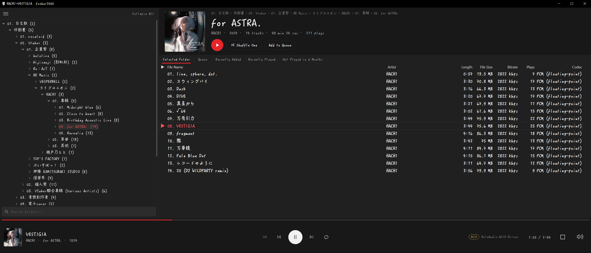
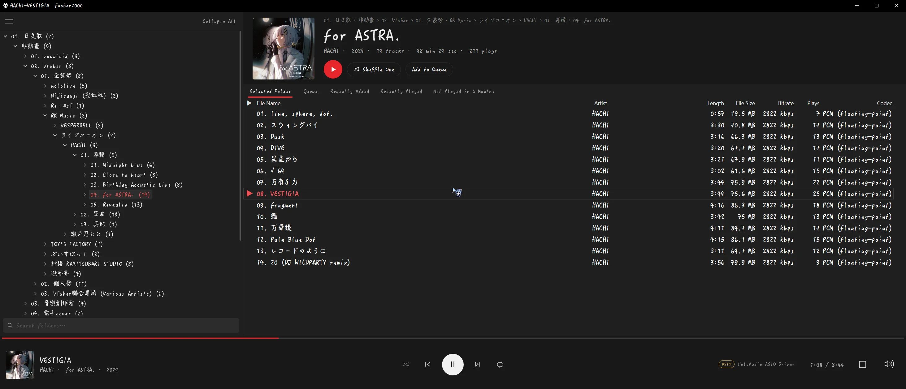
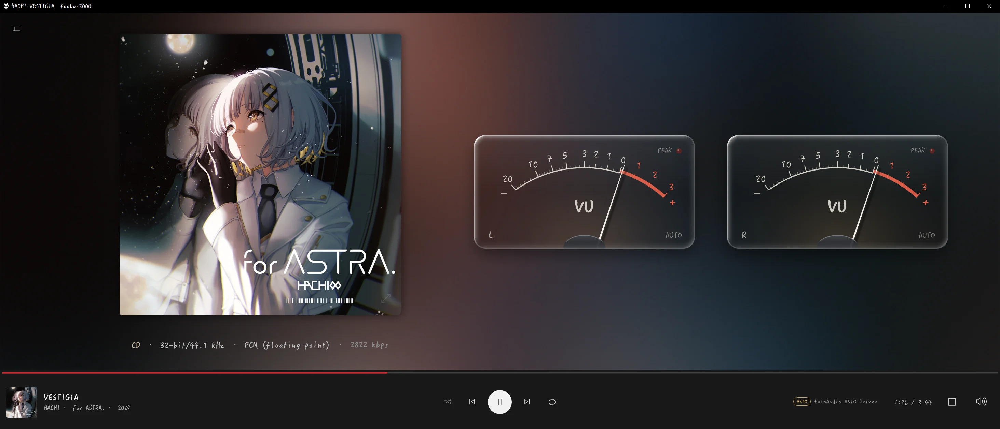
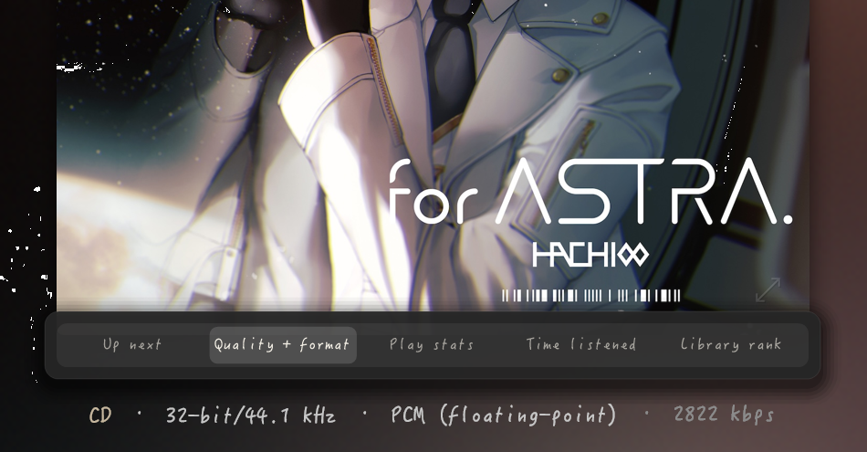
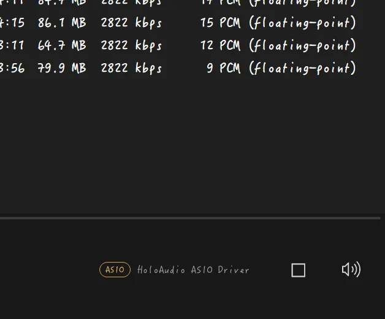
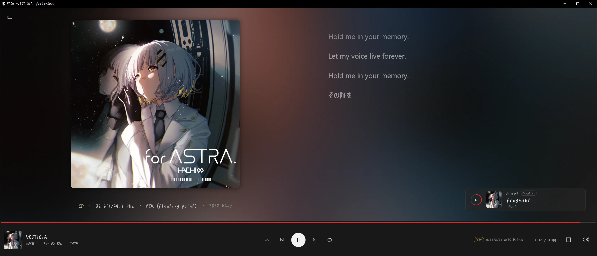
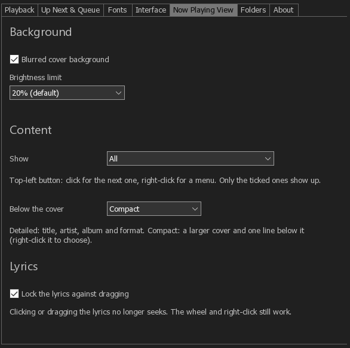

# Nocturne for foobar2000

[繁體中文](https://github.com/openeric2000/fb2k-nocturne/blob/main/README.md) | **English**

A dark, streaming-style theme for foobar2000 (fb2k below): an album header on top, underlined playlist tabs, and an expandable now playing view with lyrics.

Made for people who sort music into **folders**: the folder tree is on the left, and the album header shows the name, artist, year, track count and total length of whichever level you click.

Download: https://github.com/openeric2000/fb2k-nocturne/releases (the installer `Nocturne-Setup-v2.0.exe` is recommended; the ZIP is there for installing by hand)

A fresh fb2k install is recommended. Installing on an fb2k you already use overwrites your interface settings and fonts; the installer backs up first, and if you install by hand, back up yourself. See ["Installation"](#installation).

## Features

The screenshots use the author's own music library and font.

### Now playing view

Click the playback bar to expand it, click again to collapse. The background is a blurred version of the current cover, and the whole view cross-fades when the track changes.

Click the cover to flip it to a track info card; the zoom button is at the cover's bottom right.

### What it shows

The button at the top left switches what the now playing view shows.

### The line under the cover

The line under the cover shows quality + format by default.  
Quality is lossy, CD, Hi-Res or DSD.

### Output device

The playback bar shows the current output device; click it to switch.

### Up Next card

When a track is about to end, the next track appears at the bottom right of the now playing view and starts after a countdown.

### Preferences page

File → Preferences → Tools → Nocturne. Changes take effect immediately.

## Requirements

- Windows 10 or 11
- fb2k 2.x **64-bit** (32-bit is not supported)
- Microsoft Edge WebView2 Runtime (built into Windows 11; most Windows 10 PCs already have it)
- An SSD is recommended. On an HDD, startup is slower.

## Installation

The **profile folder** comes up often below: for the portable version it is the `profile` folder next to `foobar2000.exe`; for the installed version it is `%APPDATA%\foobar2000-v2` (paste it into the File Explorer address bar and press Enter to open it).

### With the installer (recommended)

1. Download `Nocturne-Setup-v2.0.exe` from [Releases](https://github.com/openeric2000/fb2k-nocturne/releases) and double-click it.
2. Pick the language and where fb2k is. If a component is missing, the installer lists its download page; once downloaded, come back and click "Install downloaded components". There is no need to open fb2k's Preferences.
3. Before installing, it backs up the whole profile folder next to it (the folder name has the date and time). Your existing playlists are added after the theme's five.
4. Open fb2k and choose **Columns UI** when asked for an interface. The first start takes longer while it builds the folder tree and caches.

To remove it, run `Uninstall Nocturne.exe` in the profile folder (`Nocturne 解除安裝.exe` for the Chinese version). It puts back the files from before the install; playlists and lyrics added since then stay.

The installer is not digitally signed, so Windows may stop it the first time:

- "Windows protected your PC": click "More info", then "Run anyway".
- "Open File - Security Warning": click "Run".
- With Smart App Control turned on in Windows 11, unsigned programs are blocked outright; install by hand instead (below).
- If your antivirus flags it, you can check the file on [VirusTotal](https://www.virustotal.com/).

### Installing by hand

| Your situation | What to do |
|----------------|------------|
| A fresh fb2k (recommended) | Follow [Steps 1-4](#step-1-install-foobar2000-and-three-required-components-do-this-first) below |
| An fb2k you already use, without Nocturne | **Back up the profile folder first**, then follow [Steps 1-4](#step-1-install-foobar2000-and-three-required-components-do-this-first). Your interface settings are replaced by the theme's; see ["Installing on a foobar2000 you already use"](#installing-on-a-foobar2000-you-already-use) |
| Nocturne already installed (any version, or switching language) | **Back up the profile folder first**, then overwrite everything ([Step 2](#step-2-close-foobar2000-and-copy-the-zip-contents-into-the-profile-folder)). For what goes back to the defaults, see ["Installing on a foobar2000 you already use"](#installing-on-a-foobar2000-you-already-use) |

#### Step 1: Install foobar2000 and three required components (do this first)

The authors of these three components do not allow redistribution, so they are not included; download them from their official pages. **Install all three and restart fb2k before [Step 2](#step-2-close-foobar2000-and-copy-the-zip-contents-into-the-profile-folder)**; if one is missing, the lyrics, album header or play counts will not show.

1. Install fb2k 2.x 64-bit: https://www.foobar2000.org/download (installer or portable both work)
2. Download the three components (all are `.fb2k-component` files):

   | Component | Used for | Download | Tested version |
   |-----------|----------|----------|----------------|
   | ESLyric | Playback bar, now playing view, lyrics | https://github.com/ESLyric/release/releases | 1.0.7.0 (older versions do not work) |
   | WebView2 (foo_webview2) | Album header at the top | https://www.foobar2000.org/components/view/foo_webview2 | 0.3.29 |
   | Playback Statistics (foo_playcount) | Plays column, "Recently Played" and "Not Played in 6 Months" playlists | https://www.foobar2000.org/components/view/foo_playcount | 3.1.11 |

   If you already have ESLyric, check its version too: below 1.0.7.0, the icons in the playback bar show as empty boxes and there is no play button. Install the new version as in item 3.

3. Open fb2k → File → Preferences → Components → click "Install..." and pick each downloaded `.fb2k-component`. After adding all three, click OK and restart fb2k when asked.
4. After the restart, go back to Preferences → Components and check that ESLyric, WebView2 and Playback Statistics are all listed.

#### Step 2: Close foobar2000 and copy the ZIP contents into the profile folder

1. File → Exit to close fb2k.
2. Open the profile folder (see the start of ["Installation"](#installation)).
3. In File Explorer, double-click the ZIP to open it → Ctrl+A → Copy → go back to the profile folder and paste. When asked about existing files, choose "Replace the files in the destination".

After copying, folders such as `user-components-x64`, `configuration`, `eslyric-data` and `webview` should be directly inside the profile folder; if they ended up one folder deeper, the theme will not work. The `Docs` folder only holds the license files; keep it or delete it.

#### Step 3: Open foobar2000 and switch to the theme

1. Open fb2k. When it asks which user interface to use, choose Columns UI.
2. If a "Quick setup – Columns UI" window appears, **just click Cancel** and do not pick a layout in it. Picking a layout and clicking OK replaces the theme's layout.

#### Step 4: Add your music folders

File → Preferences → Media Library → click "Add..." and add your music folders. The folder tree on the left follows your folder structure.

### Lyrics: where they come from, where they are saved, where to change settings

The ESLyric settings are already tuned and installed with the theme. During playback ESLyric first looks for lyric files on your computer (in the song's folder, or in the `lyrics` folder inside the profile folder); only if nothing is found does it search NetEase Cloud Music, Kugou, QQ Music, NetEase English, LRCLIB, MiniLyrics and Musixmatch online. **Online searches send the song title and artist to those services**; how to turn them off is below.

Synced lyrics that are found are saved to the `lyrics` folder inside the profile folder:

- Portable: `foobar2000\profile\lyrics\`
- Installed: `%APPDATA%\foobar2000-v2\lyrics\`

Lyric settings are in File → Preferences → Tools → ESLyric:

- No online searches: under "Lyric Options" turn off "Automatically search on playback start", or untick the sources you do not want under "Lyric Sources" (the built-in "Local File" source only reads lyric files on your computer).

## Installing on a foobar2000 you already use

Your current interface settings are replaced with the theme's. The installer backs up for you and can uninstall; if you install by hand, back up before choosing "Replace the files" in [Step 2](#step-2-close-foobar2000-and-copy-the-zip-contents-into-the-profile-folder):

1. File → Exit to close fb2k.
2. Copy the whole profile folder to somewhere else.
3. To go back later, close fb2k, copy the backup back into the profile folder and choose "Replace" when asked.

### What gets replaced

- **Interface settings**: the Columns UI layout, playlist columns, colours, the status bar and so on. An official Columns UI is simply replaced by the theme's modified one (no conflict), but your layout changes are gone.
- **Fonts**: the fonts of the lists, tabs, folder tree, playback bar, now playing view and album header go back to the theme's default, Segoe UI; to change them, see ["Fonts"](#fonts).
- **Album list settings**.
- **ESLyric settings**: lyric sources and their order, search and save settings, the desktop lyric and so on. Lyrics are now saved to the `lyrics` folder inside the profile folder; lyric files you kept elsewhere are not deleted, but ESLyric no longer looks or saves there. To keep your own ESLyric settings, skip `configuration\foo_uie_eslyric.dll.cfg` when copying and do not copy `eslyric-data\scripts`.
- **Playlists**: the five playlists that come with the theme (Selected Folder, Queue, Recently Added, Recently Played, Not Played in 6 Months) go back to their defaults.
  - With the installer: your other playlists are added after the theme's; ones with the same name as a theme playlist are left out and come back after uninstalling.
  - By hand: your other playlists no longer appear in the tabs, and fb2k deletes their files when it closes. Only your backup can bring them back.

### What is not affected

- fb2k's own settings: output device, media library folders, keyboard shortcuts, DSP and so on.
- Your media library and play counts.
- The lyric files you have already saved.
- The settings of other components.

To leave your current fb2k untouched, install a separate portable fb2k and try the theme there.

## Fonts

The theme uses **Segoe UI**, which comes with Windows, so there is nothing to install. Segoe UI has no Chinese or Japanese characters; if your library has many Chinese or Japanese titles, switch to one of these free fonts. Tested against about 100,000 Chinese and Japanese song and folder names, each is missing fewer than 0.2% of the characters:

| Font | Style | Missing | Download |
|------|-------|---------|----------|
| LXGW WenKai TC | Handwritten Kai style, matches the theme best (recommended) | 0.17% | https://github.com/lxgw/LxgwWenkaiTC/releases |
| Chiron Hei HK | Sans-serif, clean and easy to read | 0.06% | https://github.com/chiron-fonts/chiron-hei-hk/releases |
| Chiron GoRound TC | Rounded, softer look | 0.19% | https://github.com/chiron-fonts/chiron-go-round-tc/releases |

After downloading, right-click the font file → "Install" (or "Install for all users"), then change it on the "Fonts" tab of the preferences page. The playback bar, now playing view and album header need an fb2k restart after the change.

The lyrics font is set in ESLyric:

- Lyrics: right-click the lyrics → Panel Options....
- Desktop lyric (off by default): File → Preferences → Tools → ESLyric → Desktop Lyric → Display settings.

## Tips

### A keyboard shortcut that jumps to the playing track

Give fb2k's "Activate now playing" a keyboard shortcut, and one key press selects the playing track in a long playlist (the example uses `F4`):

1. File → Preferences → Keyboard Shortcuts, then click "Add new".
2. In the Action section, type `Activate now playing` into "Filter list by", then click View → Playlist view → Activate now playing in the list.
3. Click the Key field at the bottom and press the key you want, then click Apply → OK.

## Notes

- **Do not replace Columns UI through fb2k's component updates.** This theme uses a modified Columns UI; the official version lacks the now playing view, the underlined tabs and other features.
- The same goes for Album list: the theme ships a modified version.
- To go back to plain fb2k: delete the whole profile folder, then reinstall or re-extract the official version.

## License

- The theme itself (ESLyric layout and settings file, album header page, settings files, default playlists, documentation): MIT License, see [LICENSE](LICENSE)
- The bundled ESLyric lyric source scripts come from the official ESLyric script repository and have no license of their own; see [THIRD-PARTY-NOTICES.en.md](THIRD-PARTY-NOTICES.en.md) for their origin and details
- The modified Columns UI and the other bundled components: see [THIRD-PARTY-NOTICES.en.md](THIRD-PARTY-NOTICES.en.md)
