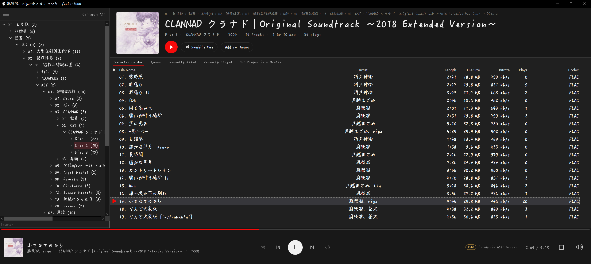
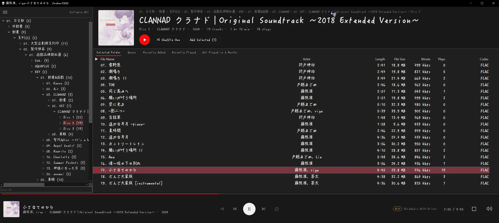
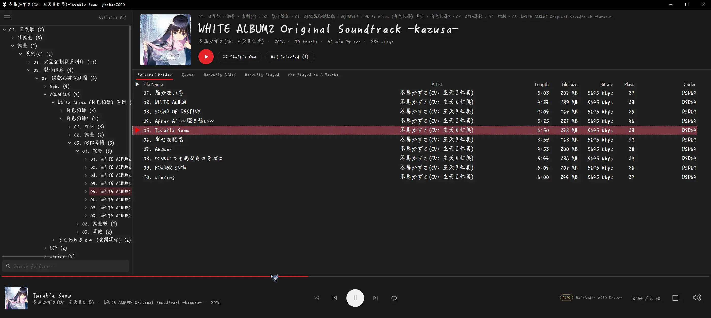
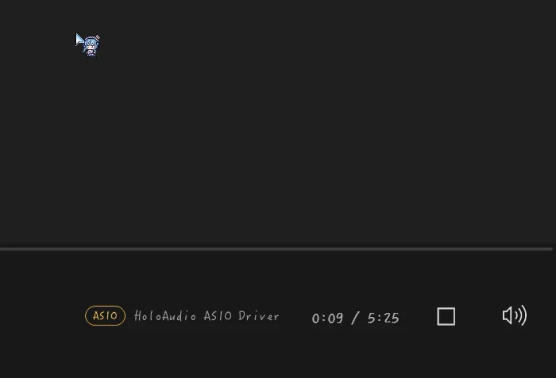
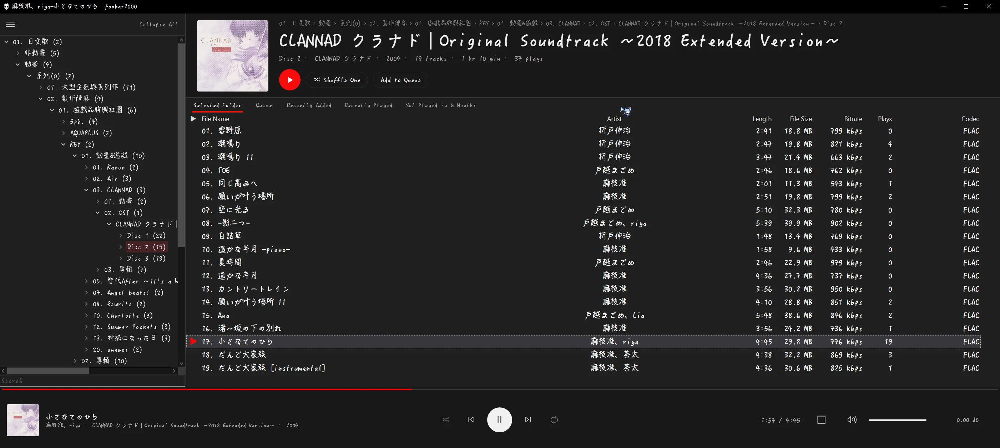
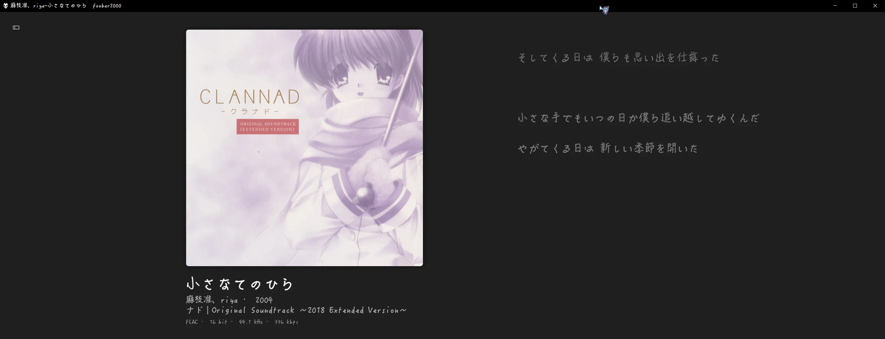
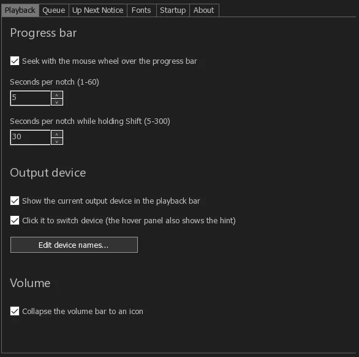
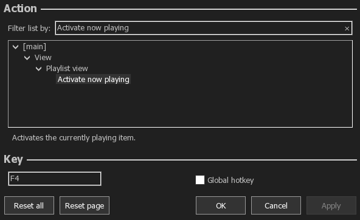

# Nocturne for foobar2000

[繁體中文](https://github.com/openeric2000/fb2k-nocturne/blob/main/README.md) | **English**

A dark, streaming-style look for foobar2000: an album header on top, underlined playlist tabs, and an expandable now playing view with lyrics.

Nocturne is built around **folder structure**: I sort my music into nested folders, so the interface centers on the folder tree on the left and the album header at the top, which shows the name, artist, year, track count and total length of whichever level you click.

Download: https://github.com/openeric2000/fb2k-nocturne/releases

- First installation: download the **Full** ZIP.
- You already have Nocturne: download the **Update** ZIP; see ["Updating to a new version"](#updating-to-a-new-version).

A fresh foobar2000 install is recommended. Installing on a foobar2000 you already use overwrites your interface settings, fonts and playlists, so back up first; see ["Installation"](#installation).

## Features

v1.40 also brings a number of interface and speed improvements, such as a blurred cover background on the now playing view, thin scroll bars, a new folder search box, a vinyl picture for tracks without a cover, and faster album header updates.

The animations below were recorded with the author's own music library and font; see ["Fonts"](#fonts) to change the font.

### Now playing view

Click the now playing bar to expand it into a now playing view with a large cover and the lyrics. Click again to collapse it.

### Blurred cover background

The background of the now playing view takes on a soft, blurred version of the current cover, so every track looks different. To turn it off or dim it, go to File → Preferences → Tools → Nocturne → "Interface" tab.

### Output device

The playback bar shows which device the sound is going to: an output type on the left (Default, Exclusive, ASIO, Muted) and the device name on the right. Hover over it to see the full name and the output mode; click it to switch device.

- To change the displayed name: File → Preferences → Tools → Nocturne → "Playback" → "Edit device names...". Write one line per device as "text the device name contains=name to show", for example `Holo Audio=DAC (Holo Audio)`. It takes effect right after you save.
- To turn it off: untick "Show the current output device in the playback bar" on the same page.

### Mouse wheel on the progress bar

Put the mouse over the progress bar and scroll to seek: up to go forward, down to go back, 5 seconds per notch, or 30 seconds per notch while holding Shift. You can change the seconds on the "Playback" tab of the preferences, or turn it off.

### Queue

The "Add to Queue" button in the album header adds the whole playlist to the playback queue; select some tracks first and it adds only those. The "Queue" tab shows what is in the queue: select some tracks and press "Remove Selected (N)" to take only those out; with nothing selected, press "Remove from Queue" and press again within 3 seconds to clear the whole queue.

Playing another track (double-click, Enter, or right-click → Play) keeps the queue by default. To go back to foobar2000's default behavior (playing another track clears the queue), go to File → Preferences → Tools → Nocturne → "Up Next & Queue" tab and untick "Keep the queue when playing another track (double-click, Enter, Play)".

### Up Next card

On the expanded now playing view, when a track is about to end, an Up Next card appears at the bottom right with the next track's cover, title, artist and a countdown; when it reaches 0, the next track starts. The countdown length, position and card size can be changed in File → Preferences → Tools → Nocturne → "Up Next & Queue" tab.

### Preferences page

The theme's own settings are in File → Preferences → Tools → Nocturne and take effect immediately. See ["Fonts"](#fonts) below for changing the fonts.

## Requirements

- Windows 10 or 11
- foobar2000 2.x **64-bit** (32-bit is not supported)
- Microsoft Edge WebView2 Runtime (built into Windows 11; most Windows 10 PCs already have it)
- An SSD is recommended. On an HDD the window takes a long time to appear on the first launch, and the startup fade-in does not take effect; from the second launch on, with the files cached, the fade-in shows up.

## Installation

The **profile folder** comes up often below: for the portable version it is the `profile` folder next to `foobar2000.exe`; for the installed version it is `%APPDATA%\foobar2000-v2` (paste it into the File Explorer address bar and press Enter to open it).

Find your situation first:

| Your situation | What to do |
|----------------|------------|
| A fresh foobar2000 (recommended) | Follow [Steps 1-4](#step-1-install-foobar2000-and-three-required-components-do-this-first) below |
| A foobar2000 you already use, without Nocturne | **Back up the profile folder first**, then follow [Steps 1-4](#step-1-install-foobar2000-and-three-required-components-do-this-first) (ESLyric must be 1.0.7.0 or newer; update it first if it is older). Your interface settings, fonts, Album list settings, ESLyric settings and playlists are replaced by the theme's; see ["Installing on a foobar2000 you already use"](#installing-on-a-foobar2000-you-already-use) |
| Nocturne already installed (for example v1.30), and you want a newer version in the same language | Download the Update ZIP and see ["Updating to a new version"](#updating-to-a-new-version): your playlists and foobar2000's core settings stay (the Columns UI and ESLyric settings are replaced with the theme's) |
| Switching from the Chinese version to the English one (or the other way round) | Overwrite everything with the Full ZIP (as in [Step 2](#step-2-close-foobar2000-and-copy-the-zip-contents-into-the-profile-folder)). Do not use the Update ZIP, or the now playing bar will be blank |

### Step 1: Install foobar2000 and three required components (do this first)

The authors of these three components do not allow redistribution, so they are not included. Please download them from their official pages.

**Install all three and restart foobar2000 before going on to [Step 2](#step-2-close-foobar2000-and-copy-the-zip-contents-into-the-profile-folder).** If any of them is missing, the lyrics, album header or play counts will not show.

1. Install foobar2000 2.x 64-bit: https://www.foobar2000.org/download (installer or portable both work)
2. Download the three components (all are `.fb2k-component` files):

   | Component | Used for | Download | Tested version |
   |-----------|----------|----------|----------------|
   | ESLyric | Now playing bar, now playing view, lyrics | https://github.com/ESLyric/release/releases | 1.0.7.0 (older versions do not work) |
   | WebView2 (foo_webview2) | Album header at the top | https://www.foobar2000.org/components/view/foo_webview2 | 0.3.28 |
   | Playback Statistics (foo_playcount) | Plays column, "Recently Played" and "Not Played in 6 Months" playlists | https://www.foobar2000.org/components/view/foo_playcount | 3.1.11 |

   **If you already have ESLyric, check its version too**: below 1.0.7.0 (for example 1.0.6.2), the icons in the now playing bar show as empty boxes and there is no play button. Install the new version again as in item 3 below.

3. Open foobar2000 → File → Preferences → Components → click "Install..." and pick each downloaded `.fb2k-component`. After adding all three, click OK and restart foobar2000 when asked.
4. After the restart, go back to Preferences → Components and check that ESLyric, WebView2 and Playback Statistics are all listed.

### Step 2: Close foobar2000 and copy the ZIP contents into the profile folder

(This step uses the Full ZIP.)

1. File → Exit to close foobar2000.
2. Open the profile folder (see the start of ["Installation"](#installation) above).
3. In File Explorer, double-click the ZIP to open it → Ctrl+A → Copy → go back to the profile folder and paste. When asked about existing files, choose "Replace the files in the destination".

After copying, folders such as `user-components-x64`, `configuration`, `eslyric-data` and `webview` should be directly inside the profile folder. If they ended up one folder deeper, the theme will not work. The `Docs` folder only contains this guide and the license files; you can keep or delete it.

### Step 3: Open foobar2000 and switch to the theme

1. Open foobar2000. Because a new user interface component was added, foobar2000 asks which user interface to use. Choose Columns UI.
2. If a "Quick setup – Columns UI" window appears, **just click Cancel** and do not pick any layout in it. Picking a layout and clicking OK replaces the theme's layout.

### Step 4: Add your music folders

File → Preferences → Media Library → click "Add..." and add your music folders. The folder tree on the left follows your folder structure.

### Lyrics: where they come from, where they are saved, where to change settings

The ESLyric settings are already tuned for you (they are installed together with the theme), and lyrics are searched for automatically during playback:

1. First, lyric files on your computer: in the same folder as the song, or in the `lyrics` folder inside the profile folder.
2. Only if nothing is found, ESLyric goes online and searches NetEase Cloud Music, Kugou, QQ Music, NetEase English, LRCLIB, MiniLyrics and Musixmatch. **This sends the song title and artist to those services**; how to turn it off is below.

Synced lyrics that are found are saved automatically to the `lyrics` folder inside the profile folder. Nothing to set up:

- Portable: `foobar2000\profile\lyrics\`
- Installed: `%APPDATA%\foobar2000-v2\lyrics\`

To change the lyric settings, go to File → Preferences → Tools → ESLyric:

- Do not want online searches: under "Lyric Options" turn off "Automatically search on playback start", or untick the sources you do not want under "Lyric Sources" (the built-in "Local File" source only reads lyric files on your computer).
- Want more lyric sources: "Get More..." at the top right of the "Lyric Sources" page.
- Where lyrics are saved and when: "Save Settings".

### Optional: a keyboard shortcut that jumps to the playing track

In a long playlist it can be hard to see which track is playing. You can give foobar2000's "Activate now playing" a keyboard shortcut; one key press finds the playing track in the list and selects it. Shortcuts are foobar2000's own settings, so the theme does not assign one for you. Set it up once (the example below uses `F4`; use any key you like):

1. File → Preferences → Keyboard Shortcuts, then click "Add new".
2. In the Action section, type `Activate now playing` into "Filter list by", then click View → Playlist view → Activate now playing in the list.
3. Click the Key field at the bottom and press the key you want (`F4` in the example), then click Apply → OK.

## Installing on a foobar2000 you already use

You can, but know this first: in [Step 2](#step-2-close-foobar2000-and-copy-the-zip-contents-into-the-profile-folder), when you copy the ZIP contents and choose "Replace the files in the destination", your current interface settings are replaced with the theme's. So back up first.

### Back up first

1. File → Exit to close foobar2000.
2. Copy the whole profile folder to somewhere else.
3. To go back later, close foobar2000, copy the backup back into the profile folder and choose "Replace" when asked.

### What gets replaced

- **Interface settings**: the Columns UI layout, the playlist columns, colours, the status bar and so on are replaced with the theme's. If you already use Columns UI and have customized the layout, your changes will be gone (an official Columns UI you installed is simply replaced by the theme's modified one; they do not conflict).
- **Fonts**: the fonts of the lists, tabs, folder tree, now playing bar, now playing view and album header go back to the theme's default, Segoe UI. To use another font, choose it again in View → Layout → Theme Font….
- **Album list settings**.
- **ESLyric settings**: the lyric sources and their order, the search and save settings, the desktop lyric and so on are replaced with the theme's. Lyrics are now saved to the `lyrics` folder inside the profile folder; lyric files you kept somewhere else are not deleted, but ESLyric no longer looks there or saves there. To keep your own ESLyric settings, choose "Skip" for the file `configuration\foo_uie_eslyric.dll.cfg` when copying the ZIP contents, **and do not copy** the `eslyric-data\scripts` folder (if you skip only the settings file but copy the scripts, the 7 online sources appear at the end of your source list, ticked).
- **Album header page**: if you put your own page in `webview\default\` in the profile folder, it is replaced by the theme's.
- **Playlists**: the five playlists that come with the theme (Selected Folder, Queue, Recently Added, Recently Played, Not Played in 6 Months) go back to their defaults. Other playlists you made are not deleted, but they no longer appear in the playlist tabs (restoring your backup brings them back).

### What is not affected

- foobar2000's own settings: output device, media library folders, keyboard shortcuts, DSP and so on.
- Your media library and play counts.
- The lyric files you have already saved (but your ESLyric settings are replaced, see above).
- The settings of other components.

### If you do not want to touch your current foobar2000

Install a separate portable foobar2000 and try the theme there. The one you use now is not touched at all.

## Updating to a new version

If you already have Nocturne and want a newer version **in the same language**, download the Update ZIP (its name contains `update`, for example `fb2k-nocturne-v1.40-update-en.zip`) and extract it over your profile folder:

1. File → Exit to close foobar2000.
2. **Back up the `configuration` folder in your profile folder** (see the start of ["Installation"](#installation)).
3. In File Explorer, double-click the Update ZIP to open it → Ctrl+A → Copy → paste into the profile folder. When asked about existing files, choose "Replace the files in the destination". (File Explorer merges the folders and only replaces files with the same name, so your other components and files are not deleted.)
4. Start foobar2000 again.

**Since v1.40 the Update ZIP also replaces the Columns UI settings.** Many new features (for example the blurred cover background of the now playing view) keep their settings there and do not work without it.

Replaced with the new version:

- The three components (Columns UI, Album list, foo_queue_mirror).
- ESLyric: the layout `main.xml`, the online lyric source scripts and the ESLyric settings file (lyric source order, search and save settings).
- The album header page (`webview`).
- **The Columns UI settings file `configuration\foo_ui_columns.dll.cfg`**: the layout (panel arrangement and sizes, lyric panel settings), playlist columns, fonts and colours, and every option on the Nocturne preferences page.
- The vinyl picture shown for tracks without a cover, `no-cover.png` (new).

Not touched: your playlists, the media library, foobar2000's core settings (output device, volume, keyboard shortcuts, the no-cover stub setting), Album list's own settings file, your lyric files and other components.

Notes:

- **To keep your own Columns UI settings**, choose "Skip this file" for `configuration\foo_ui_columns.dll.cfg` while copying. The cost: no blurred cover background and the old playlist columns; the other new features work as usual. To update only the columns, download `fb2k-nocturne-v1.40-playlist-columns-en.fcl` from the Release page of this version (the Chinese version has `-zh-TW.fcl`; neither is inside a ZIP), then File → Preferences → Display → Columns UI → "Setup" tab → "Import configuration…", pick it, keep the default ticks and click OK (this replaces your playlist column settings).
- If you have edited `main.xml` or picked other fonts, do it again after updating: the fonts of the now playing bar, now playing view and album header go back to the default. Choose them again in Tools → Nocturne → "Fonts" or in View → Layout → Theme Font….
- Your ESLyric settings are replaced with the theme's, including the 7 online lyric sources and their order, the search and save settings, the desktop lyric and so on. When no local lyrics are found, ESLyric goes online during playback; how to turn that off is described above in ["Lyrics: where they come from, where they are saved, where to change settings"](#lyrics-where-they-come-from-where-they-are-saved-where-to-change-settings). To keep your own ESLyric settings, see the ESLyric item under ["What gets replaced"](#what-gets-replaced) above.
- To switch language (Chinese version to English, or the other way round), do not use the Update ZIP. Overwrite everything with the Full ZIP (after making a backup). The settings files still remember the names of the other language, so replacing only the theme files leaves the now playing bar blank.
- If you are not sure, overwrite everything with the Full ZIP as described in ["Installing on a foobar2000 you already use"](#installing-on-a-foobar2000-you-already-use) above, after making a backup.

## Fonts

The theme uses **Segoe UI**, which comes with Windows, so there is nothing to install. Segoe UI does not include Chinese or Japanese characters. If your library has many Chinese or Japanese titles, switch to one of the recommended fonts below.

### Recommended fonts

These free fonts cover both Chinese and Japanese well. Tested against about 100,000 Chinese and Japanese song and folder names, each is missing fewer than 0.2% of the characters:

| Font | Style | Missing | Download |
|------|-------|---------|----------|
| LXGW WenKai TC | Handwritten Kai style, matches the theme best (recommended) | 0.17% | https://github.com/lxgw/LxgwWenkaiTC/releases |
| Chiron Hei HK | Sans-serif, clean and easy to read | 0.06% | https://github.com/chiron-fonts/chiron-hei-hk/releases |
| Chiron GoRound TC | Rounded, softer look | 0.19% | https://github.com/chiron-fonts/chiron-go-round-tc/releases |

After downloading, right-click the font file → "Install" (or "Install for all users"), then change the theme font as described below.

### Changing the theme font

**To change everything at once**, use "Theme Font…" below. **To change one area at a time**, go to File → Preferences → Tools → Nocturne → "Fonts" tab. The top row, "All parts", is the same as "Theme Font…", and the six rows below each control one area:

- Playlist, Playlist tabs, Folder tree, Other interface text: both the font and the size can be changed, and it is applied immediately.
- Now playing bar and view, Album header: only the font can be changed (the size is fixed), it takes effect after restarting foobar2000, and a "Restart now" button appears at the bottom of the tab once you change one.
- The lyrics font is not here; see step 4 below.

Steps for "Theme Font…":

1. Main menu View → Layout → Theme Font… (also available from the ☰ button at the top left → View → Layout).
2. Pick a font and an overall size → OK. The lists, tabs, folder tree, now playing bar, now playing view and album header all change together.
3. When the message appears, click "Yes" to restart foobar2000 so the now playing bar and album header pick up the new font.
4. The lyrics font is set separately: right-click the lyrics → Panel Options... and change the font there.
5. The desktop lyric (off by default) has its own font: File → Preferences → Tools → ESLyric → Desktop Lyric → Display settings.

- The weight is always Regular.
- The overall size (Small / Standard / Large / Extra Large) only scales the lists, tabs and folder tree; the now playing bar and album header keep their size. Choose "Standard" to go back to the theme's original size.

To fine-tune individual items, go to File → Preferences → Display → Columns UI → Colours and fonts → Fonts. When you change the font family there, the style below jumps to the first entry in the list (often Light), so remember to set it back to Regular.

## Notes

- **Do not replace Columns UI through foobar2000's component updates.** This theme uses a modified Columns UI; the official version lacks the now playing view, the underlined tabs and other features.
- **The same goes for Album list (since v1.40).** The theme ships a modified version; the official one lacks the new search box and the "Search Album list" command. Put the file from the ZIP back if that happens.
- To go back to plain foobar2000: delete the whole profile folder, then reinstall or re-extract the official version.
- So far tested only on Windows 10 (Traditional Chinese edition) with foobar2000 2.26.1. Not yet tested on English Windows or on Windows 11 (where the Segoe MDL2 Assets font used by the now playing bar icons and the ☰ button has not been checked).

## License

- The theme itself (ESLyric layout and settings file, album header page, settings files, default playlists, documentation): MIT License, see [LICENSE](LICENSE)
- The bundled ESLyric lyric source scripts come from the official ESLyric script repository and have no license of their own; see [THIRD-PARTY-NOTICES.en.md](THIRD-PARTY-NOTICES.en.md) for their origin and details
- The modified Columns UI and the other bundled components: see [THIRD-PARTY-NOTICES.en.md](THIRD-PARTY-NOTICES.en.md)
