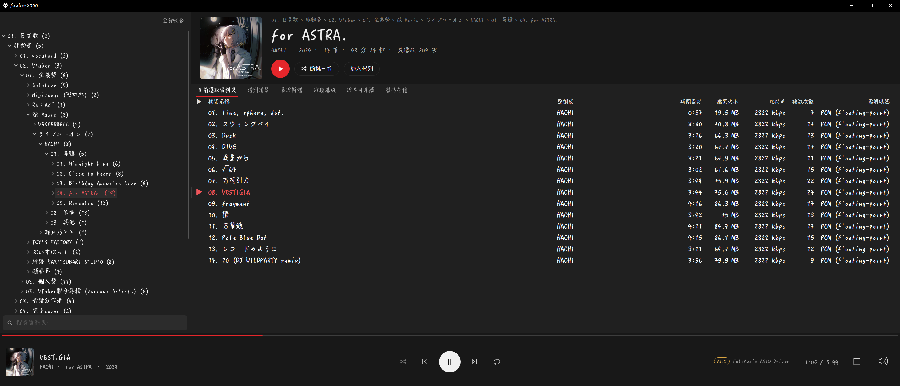
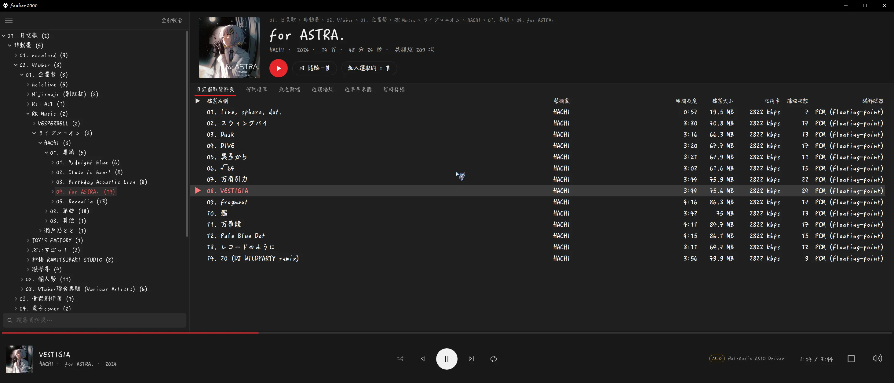
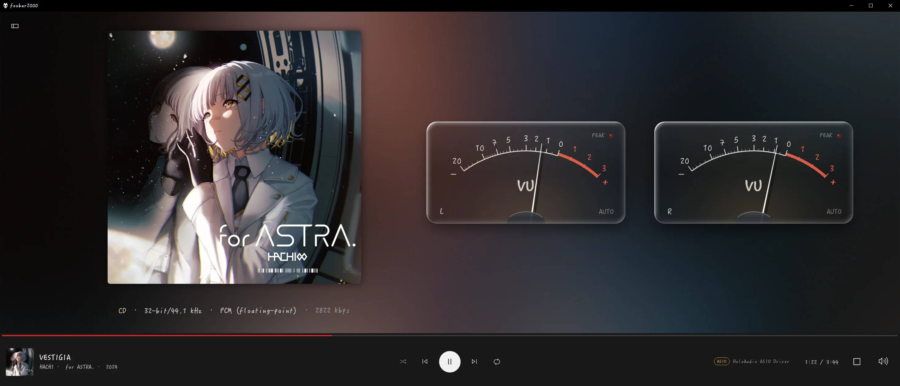
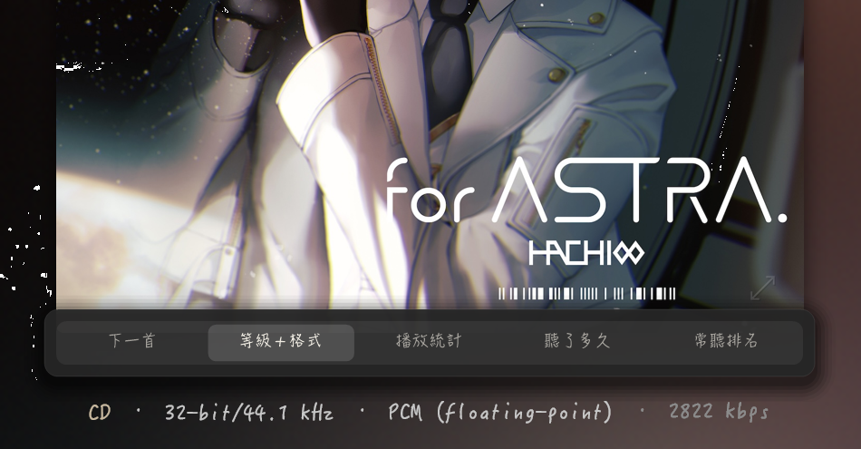
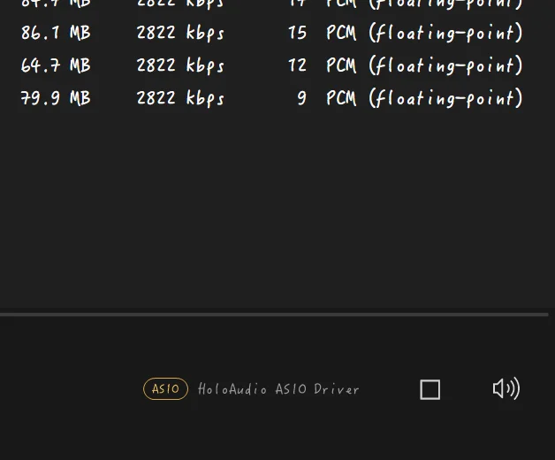
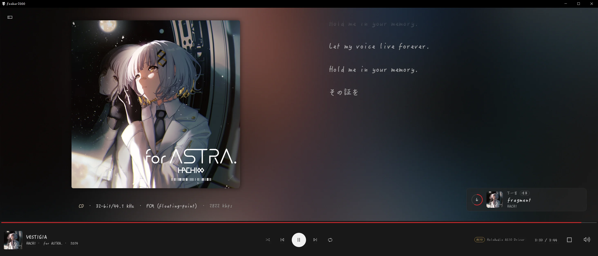
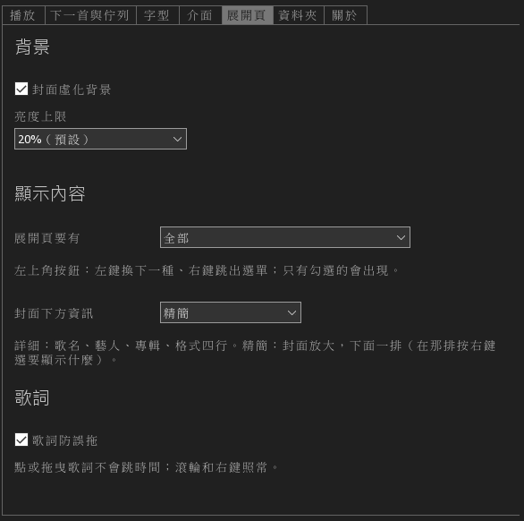

# Nocturne for foobar2000

**繁體中文** | [English](https://github.com/openeric2000/fb2k-nocturne/blob/main/README.en.md)

深色、串流平台風格的 foobar2000（下稱 fb2k）主題：上方專輯標頭、底線式分頁、展開播放頁與歌詞。

給照**資料夾**整理音樂的人用：左邊是資料夾樹，點到哪一層，上方標頭就顯示那一層的名稱、歌手、年份、曲數和總長。

下載：https://github.com/openeric2000/fb2k-nocturne/releases（建議用安裝程式 `Nocturne-Setup-v2.0.exe`；也可以下載 ZIP 手動裝）

建議裝在全新安裝的 fb2k 上。裝在已經在用的 fb2k 上，會覆蓋你的介面設定和字型；安裝程式會先自動備份，手動裝請自己先備份，詳見[「安裝」](#安裝)。

## 功能

### 展開播放頁

點一下播放列展開，再點一下收回。背景是目前封面的虛化色彩，換歌時整頁交叉淡化。

點封面可換成曲目資訊卡，封面右下角有放大鈕。

### 顯示內容

左上角的按鈕可切換展開頁。

### 封面下面那一排

封面下方資訊預設為等級＋格式。  
等級分成有損、CD、Hi-Res、DSD。

### 輸出裝置

播放列上顯示目前的輸出裝置，點一下可切換。

### 下一首提示

歌曲快結束時，展開頁右下角會跳出下一首，倒數後換歌。

### 設定頁

在 File → Preferences → Tools → Nocturne，改了立刻生效。

## 需求

- Windows 10 或 11
- fb2k 2.x **64 位元**（不支援 32 位元）
- 建議裝在 SSD。裝在 HDD 的話啟動會較慢。

## 安裝

下面常提到**設定資料夾**：攜帶版是 `foobar2000.exe` 旁邊的 `profile` 資料夾；安裝版是 `%APPDATA%\foobar2000-v2`（貼到檔案總管的網址列，按 Enter 就會打開）。

### 用安裝程式（建議）

1. 從 [Releases](https://github.com/openeric2000/fb2k-nocturne/releases) 下載 `Nocturne-Setup-v2.0.exe`，雙擊執行。
2. 照畫面選語言、選 fb2k 的位置。檢查時缺元件的話，安裝程式會列出下載頁；下載好之後回到安裝程式按「安裝下載好的元件」，不用自己開 fb2k 的設定頁。
3. 按「安裝」前，安裝程式會把整個設定資料夾備份到旁邊（資料夾名稱帶日期時間）。原本的播放清單會接在主題的五個清單後面。
4. 裝好後打開 fb2k，跳出選介面的視窗時選 **Columns UI**。第一次打開要建資料夾樹和快取，會比較久。

想移除時，執行設定資料夾裡的 `Nocturne 解除安裝.exe`（英文版是 `Uninstall Nocturne.exe`），會換回安裝前的檔案；安裝後新建的清單和歌詞會留著。

安裝程式沒有數位簽章，第一次執行時 Windows 可能會擋：

- 出現「Windows 已保護您的電腦」：按「其他資訊」，再按「仍要執行」。
- 出現「開啟檔案 - 安全性警告」：按「執行」。
- Windows 11 開了「智慧型應用程式控制」的話，沒有簽章的程式會直接被擋下，請改用下面的手動安裝。
- 防毒軟體誤判時，可以把檔案送到 [VirusTotal](https://www.virustotal.com/) 檢查，或用 Releases 附的 `.sha256` 比對檔案有沒有被改過。

### 手動安裝

| 你的情況 | 怎麼做 |
|----------|--------|
| 全新的 fb2k（建議） | 照下面[第 1～4 步](#第-1-步先安裝-foobar2000-和三個必要元件一定要先做) |
| 已經在用的 fb2k，沒裝過 Nocturne | **先備份設定資料夾**，再照[第 1～4 步](#第-1-步先安裝-foobar2000-和三個必要元件一定要先做)。原本的介面設定會被主題取代，詳見[「裝在已經在用的 foobar2000 上」](#裝在已經在用的-foobar2000-上) |
| 已經裝過 Nocturne（任何版本，或想換語言） | **先備份設定資料夾**，整包覆蓋（照[第 2 步](#第-2-步關掉-fb2k把-zip-的內容複製到設定資料夾)）。哪些設定會回到預設，見[「裝在已經在用的 foobar2000 上」](#裝在已經在用的-foobar2000-上) |

#### 第 1 步：先安裝 foobar2000 和三個必要元件（一定要先做）

下面三個元件的作者沒有開放隨包轉發，主題不附，要自己從官方網站下載。**三個都裝好、重開 fb2k 之後，才能做[第 2 步](#第-2-步關掉-fb2k把-zip-的內容複製到設定資料夾)**；少一個，歌詞、專輯標頭或播放次數就無法顯示。

1. 安裝 fb2k 2.x 64 位元：https://www.foobar2000.org/download （安裝版或攜帶版都可以）
2. 下載三個元件（都是 `.fb2k-component` 檔）：

   | 元件 | 主題哪裡會用到 | 下載 | 測試過的版本 |
   |------|----------------|------|--------------|
   | ESLyric | 播放列、展開播放頁、歌詞 | https://github.com/ESLyric/release/releases | 1.0.7.0（舊版不行） |
   | WebView2（foo_webview2） | 上方的專輯標頭 | https://www.foobar2000.org/components/view/foo_webview2 | 0.3.29 |
   | Playback Statistics（foo_playcount） | 播放次數欄、「近期播放」「近半年未聽」清單 | https://www.foobar2000.org/components/view/foo_playcount | 3.1.11 |

   已經裝過 ESLyric 的人也要確認版本：低於 1.0.7.0 的話，播放列的圖示會變成方框、沒有播放鈕，請照下面第 3 步裝新版。

3. 開 fb2k → File → Preferences → Components → 按「Install...」，選剛下載的 `.fb2k-component`。三個都加進去後按 OK，照提示重開 fb2k。
4. 重開後回到 Preferences → Components，確認清單裡有 ESLyric、WebView2、Playback Statistics 三個。

#### 第 2 步：關掉 fb2k，把 ZIP 的內容複製到設定資料夾

1. File → Exit 關掉 fb2k。
2. 打開設定資料夾（位置見[「安裝」](#安裝)開頭）。
3. 在檔案總管雙擊打開 ZIP → Ctrl+A 全選 → 複製 → 回到設定資料夾貼上。問到要不要取代檔案時，選「取代目的地中的檔案」。

複製完，設定資料夾裡會直接看到 `user-components-x64`、`configuration`、`eslyric-data`、`webview` 這些資料夾；如果它們跑到多一層的資料夾裡，主題就不會生效。`主題說明` 資料夾是授權文件，留著或刪掉都可以。

#### 第 3 步：開 fb2k，換成主題介面

1. 打開 fb2k，跳出視窗讓你選介面時，選 Columns UI。
2. 萬一接著跳出「Quick setup – Columns UI」視窗，**直接按 Cancel**，不要點裡面的版面。點了版面再按 OK，主題的版面就會被換掉。

#### 第 4 步：加入音樂資料夾

File → Preferences → Media Library → 按「Add...」加入你的音樂資料夾，左邊的資料夾樹就會照你的資料夾結構顯示。

### 歌詞：怎麼找、存在哪裡、設定在哪

ESLyric 的設定已經調好，隨主題一起安裝。播放時會先找你電腦裡的歌詞檔（跟歌曲同一個資料夾，或設定資料夾裡的 `lyrics` 資料夾），找不到才連線到網易雲音樂、酷狗音樂、QQ 音樂、NetEase English、LRCLIB、MiniLyrics、Musixmatch 搜尋。**連線搜尋時會把歌名與歌手送到這些服務**，不想連線的做法在下面。

找到的同步歌詞自動存在設定資料夾裡的 `lyrics` 資料夾：

- 攜帶版：`foobar2000\profile\lyrics\`
- 安裝版：`%APPDATA%\foobar2000-v2\lyrics\`

歌詞設定在 File → Preferences → Tools → ESLyric：

- 不想連線搜尋：「歌詞選項」取消「曲目開始播放時自動搜尋歌詞」；或到「歌詞來源」取消不要的來源（內建的「本機檔案」只讀你電腦裡的歌詞檔）。
- 想把歌詞存到別的資料夾：見[「小技巧」](#把歌詞改存到其他資料夾)。

## 裝在已經在用的 foobar2000 上

原本的介面設定會被換成主題的。安裝程式會自動備份、也能解除安裝；手動裝的話，[第 2 步](#第-2-步關掉-fb2k把-zip-的內容複製到設定資料夾)選「取代檔案」之前請先備份：

1. File → Exit 關掉 fb2k。
2. 把整個設定資料夾複製一份，放到別的地方。
3. 之後想退回去，關掉 fb2k，把備份複製回設定資料夾，問到要不要取代時選「取代」。

### 會被換掉的

- **介面設定**：Columns UI 的版面、播放清單欄位、顏色、狀態列等。原本的官方 Columns UI 會被主題附的修改版取代，不會衝突，但你調過的版面會不見。
- **字型**：清單、分頁、資料夾樹、播放列、展開頁和專輯標頭的字型，會回到主題預設的微軟正黑體 UI，想換見[「字型」](#字型)。
- **Album list 的設定**。
- **ESLyric 的設定**：歌詞來源與順序、搜尋與存檔設定、桌面歌詞等。歌詞存檔位置會變成設定資料夾裡的 `lyrics` 資料夾；你原本存在別處的歌詞檔不會被刪，但 ESLyric 不會再去那裡找或存。想保留自己的 ESLyric 設定，複製時略過 `configuration\foo_uie_eslyric.dll.cfg`，也不要複製 `eslyric-data\scripts`。
- **播放清單**：主題附的五個預設清單（目前選取資料夾、佇列清單、最近新增、近期播放、近半年未聽）會變回預設內容。
  - 用安裝程式：你自己建的其他清單會接在主題清單後面；跟主題同名的不重複加，解除安裝後會回來。
  - 手動裝：你自己建的其他清單不會出現在分頁上，fb2k 關閉時還會刪掉它們的清單檔，只能從備份找回來。

### 不會受影響的

- fb2k 本身的設定：輸出裝置、媒體庫資料夾、快捷鍵、DSP 等。
- 媒體庫和播放次數紀錄。
- 已經存好的歌詞檔案。
- 其他元件的設定。

不想動到現在的 fb2k，可以另外裝一份攜帶版，在那一份上裝主題試試看。

## 字型

主題預設用 Windows 內建的**微軟正黑體 UI**，不用另外安裝。它以繁體中文為主，有些日文字沒有收錄；日文歌多的話，建議換成下面的免費字型。以約 10 萬個中日文歌名與資料夾名實測，缺字都在 0.2% 以下：

| 字型 | 風格 | 缺字 | 下載 |
|------|------|------|------|
| 霞鶩文楷 TC（LXGW WenKai TC） | 手寫楷體，跟主題風格最搭（推薦） | 0.17% | https://github.com/lxgw/LxgwWenkaiTC/releases |
| 昭源黑體（Chiron Hei HK） | 黑體，乾淨好讀 | 0.06% | https://github.com/chiron-fonts/chiron-hei-hk/releases |
| Chiron GoRound TC | 圓體，比較柔和 | 0.19% | https://github.com/chiron-fonts/chiron-go-round-tc/releases |

下載後對字型檔按右鍵 →「安裝」（或「為所有使用者安裝」），再到設定頁「字型」分頁換，播放列、展開頁和專輯標頭換完要重開 fb2k。

歌詞字型要在 ESLyric 裡換：

- 歌詞：在歌詞上按右鍵 → Panel Options...（中文介面叫「面板參數選項」）。
- 桌面歌詞（預設沒開）：File → Preferences → Tools → ESLyric → 桌面歌詞 → 顯示設定。

## 小技巧

### 指定快捷鍵，一按就跳到正在播放的那首

給 fb2k 的「Activate now playing」指定快捷鍵，在很長的清單裡一按就能選取正在播放的那一首（下面用 `F4` 當範例）：

1. File → Preferences → Keyboard Shortcuts，按「Add new」。
2. 在下方 Action 區的「Filter list by」輸入 `Activate now playing`，在清單裡點 View → Playlist view → Activate now playing。
3. 在最下方的 Key 欄位裡按下要用的按鍵，按 Apply → OK。

### 把歌詞改存到其他資料夾

想把歌詞集中放在別的位置（例如另一顆硬碟，方便備份），可以用「目錄連接點」讓 `lyrics` 資料夾指向新位置，不用改任何外掛設定。

1. 完全關閉 fb2k。
2. 在想存放歌詞的位置建立好資料夾，例如 `D:\音樂\歌詞`。
3. 把原本 `lyrics` 資料夾裡的檔案搬到新資料夾，再把原本的 `lyrics` 資料夾刪掉或改名（連結的位置不能已經有同名資料夾）。
4. 開啟命令提示字元（cmd），執行（攜帶版把前面的路徑換成 `foobar2000\profile\lyrics` 的完整路徑）：

   `mklink /J "%APPDATA%\foobar2000-v2\lyrics" "D:\音樂\歌詞"`

5. 確認 `lyrics` 變成帶小箭頭的圖示，再開 fb2k 測試。

注意事項：

- 前面的路徑是「連結的位置」，後面是「實際存放的資料夾」，順序不能寫反。
- `/J` 不需要系統管理員權限，但目標只能是本機磁碟（含外接硬碟），不能是網路磁碟機；目標硬碟沒接上時，fb2k 會讀不到、存不了歌詞。

## 注意

- **不要用 fb2k 的元件更新取代 Columns UI。** 主題用的是修改版 Columns UI，換成官方版會少掉展開播放頁、底線式分頁等功能。
- Album list 也一樣，主題附的是修改版。
- 要還原成原本的 fb2k：刪掉整個設定資料夾，重新安裝或解壓官方版。

## 授權

- 主題本身（ESLyric 佈局與設定檔、專輯標頭網頁、設定檔、預設播放清單、說明文件）：MIT License，見 [LICENSE](LICENSE)
- 隨包附上的 ESLyric 歌詞來源腳本，來自 ESLyric 官方腳本庫，作者沒有附授權條款，出處與說明見 [THIRD-PARTY-NOTICES.md](THIRD-PARTY-NOTICES.md)
- 修改版 Columns UI 與其他隨包附上的元件：見 [THIRD-PARTY-NOTICES.md](THIRD-PARTY-NOTICES.md)
