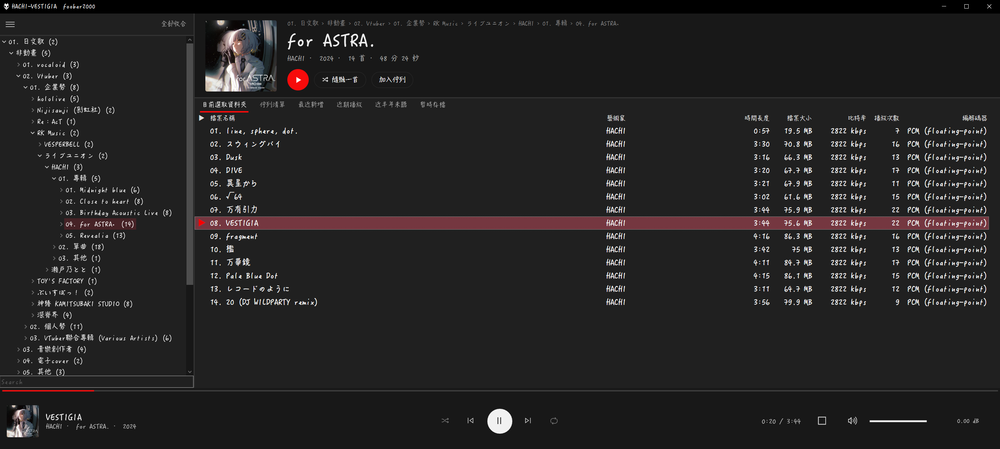
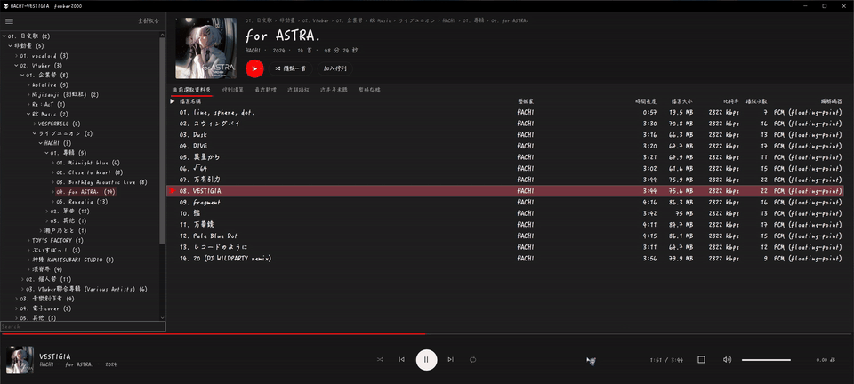
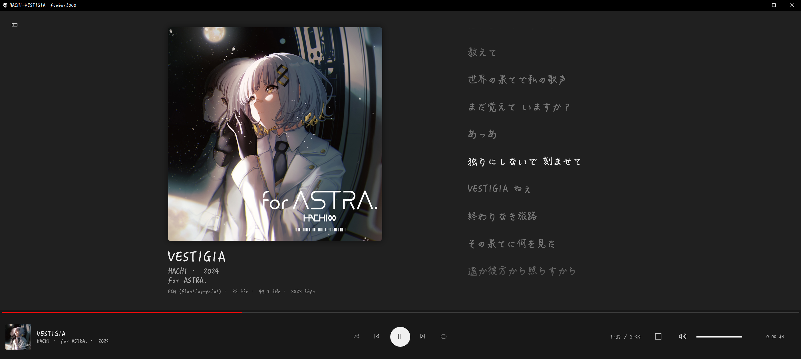

# Nocturne for foobar2000

**繁體中文** | [English](https://github.com/openeric2000/fb2k-nocturne/blob/main/README.en.md)

讓 foobar2000 換上深色、串流平台風格的介面：上方專輯標頭、底線式分頁、展開播放頁與歌詞。

下載：https://github.com/openeric2000/fb2k-nocturne/releases （中文版 `fb2k-nocturne-v1.10-zh-TW.zip`；英文版是 `fb2k-nocturne-v1.10-en.zip`）

點一下播放列就能展開播放頁，看大封面和歌詞，再點一下收回：

### 我整理音樂的方式

上方的專輯標頭，是照我自己「一層一層往下分類」的資料夾來設計的：點到哪一層，標頭就顯示那一層的名稱，以及歌手、年份、曲數和總長。資料夾名稱前面我會加 `01.`、`02.` 這類編號來排順序，最底下才是專輯，有分片的專輯再多一層 `Disc 1`、`Disc 2`。專輯有標籤就用標籤，沒有就用資料夾名稱。

**[點這裡看範例](https://openeric2000.github.io/fb2k-nocturne/)**：左邊是一個示意用的音樂庫，點每一層就會看到標頭的樣子（範例是假資料）。你的資料夾排法不一樣也沒關係，沒標籤的話會退回用資料夾名稱，常見的排法都有處理。

> **只適用全新安裝的 foobar2000。** 解壓會覆蓋介面設定，已經自己調過介面的 fb2k 請先備份整個設定資料夾。

## 需求

- Windows 10 或 11
- foobar2000 2.x **64 位元**（不支援 32 位元）
- Microsoft Edge WebView2 Runtime（Windows 11 內建，Windows 10 大多已經有）

## 安裝

### 第 1 步：先安裝 foobar2000 和三個必要元件（一定要先做）

下面三個元件的作者沒有開放隨包轉發，所以這個主題不附，要請你自己從官方網站下載安裝。

**三個都裝好、重開 fb2k 之後，才能進行第 2 步。** 少裝任何一個，歌詞、專輯標頭或播放次數會無法顯示。

1. 安裝 foobar2000 2.x 64 位元：https://www.foobar2000.org/download （安裝版或攜帶版都可以）
2. 下載三個元件（都是 `.fb2k-component` 檔）：

   | 元件 | 主題哪裡會用到 | 下載 | 測試過的版本 |
   |------|----------------|------|--------------|
   | ESLyric | 播放列、展開播放頁、歌詞 | https://github.com/ESLyric/release/releases | 1.0.7.0 |
   | WebView2（foo_webview2） | 上方的專輯標頭 | https://www.foobar2000.org/components/view/foo_webview2 | 0.3.28 |
   | Playback Statistics（foo_playcount） | 播放次數欄、「近期播放」「近半年未聽」清單 | https://www.foobar2000.org/components/view/foo_playcount | 3.1.11 |

3. 開 fb2k → File → Preferences → Components → 按「Install...」，選剛下載的 `.fb2k-component`。三個都加進去後按 OK，照提示重開 fb2k。
4. 重開後回到 Preferences → Components，確認清單裡有 ESLyric、WebView2、Playback Statistics 三個。

### 第 2 步：關掉 fb2k，把 ZIP 的內容複製到設定資料夾

1. File → Exit 關掉 fb2k。
2. 打開 fb2k 的設定資料夾：
   - 攜帶版：`foobar2000.exe` 旁邊的 `profile` 資料夾
   - 安裝版：把 `%APPDATA%\foobar2000-v2` 貼到檔案總管的網址列，按 Enter
3. 在檔案總管雙擊打開 ZIP → Ctrl+A 全選 → 複製 → 回到設定資料夾貼上。問到要不要取代檔案時，選「取代目的地中的檔案」。

複製完，設定資料夾裡會直接看到 `user-components-x64`、`configuration`、`eslyric-data`、`webview` 這些資料夾；如果它們跑到多一層的資料夾裡，主題就不會生效。`主題說明` 資料夾裝的是這份說明和授權文件，留著或刪掉都可以。

### 第 3 步：開 fb2k，換成主題介面

1. 打開 fb2k。因為多了一個介面元件，fb2k 會跳出視窗讓你選介面，選 **Columns UI**。
2. 萬一接著跳出「Quick setup – Columns UI」視窗，**直接按 Cancel**，不要點裡面的版面。點了版面再按 OK，主題的版面就會被換掉。

### 第 4 步：加入音樂資料夾

File → Preferences → Media Library → 按「Add...」加入你的音樂資料夾。左側的資料夾樹會照你的資料夾結構顯示。

### 歌詞存在哪裡

播放時找到的歌詞，會自動存在 fb2k 設定資料夾裡的 `lyrics` 資料夾，不用另外設定：

- 攜帶版：`foobar2000\profile\lyrics\`
- 安裝版：`%APPDATA%\foobar2000-v2\lyrics\`

### 把歌詞改存到其他資料夾（選用）

fb2k 預設把歌詞存在上面那個 `lyrics` 資料夾。如果你想把歌詞集中放在別的位置（例如另一顆硬碟，方便備份和整理），可以用「目錄連接點」讓 `lyrics` 指向新位置。這樣不用改任何外掛設定，存進去的歌詞會直接寫到新位置。

1. 完全關閉 fb2k。
2. 在想存放歌詞的位置建立好資料夾，例如 `D:\音樂\歌詞`。
3. 把原本 `lyrics` 資料夾裡的檔案搬到新資料夾，再把原本的 `lyrics` 資料夾刪掉或改名（連結的位置不能已經有同名資料夾）。
4. 開啟命令提示字元（cmd），執行：

`mklink /J "%APPDATA%\foobar2000-v2\lyrics" "D:\音樂\歌詞"`

5. 到 `foobar2000-v2` 資料夾確認 `lyrics` 變成帶小箭頭的圖示，再開 fb2k 測試。

注意事項：

- 前面的路徑是「連結的位置」，後面是「實際存放的資料夾」，順序不能寫反。
- 以上以安裝版為例。攜帶版請把前面的路徑換成 `foobar2000\profile\lyrics` 的完整路徑；後面的路徑請換成你自己的資料夾。
- `/J` 不需要系統管理員權限，但目標只能是本機磁碟（含外接硬碟），不能是網路磁碟機。
- 目標硬碟沒接上時，fb2k 會讀不到、存不了歌詞，請先接好再開程式。
- 要取消時，直接刪除連結資料夾即可，不會影響目標資料夾裡的檔案。

## 字型

主題預設用 Windows 內建的**微軟正黑體 UI**，不用另外安裝。微軟正黑體以繁體中文為主，日文歌名裡有些字可能沒有收錄；日文歌多的話，建議換成下面的推薦字型。

### 推薦字型

想要有中日文都較齊全的字型，可以改用下面這幾個免費字型。以約 10 萬個中日文歌名與資料夾名實測，缺字都在 0.2% 以下：

| 字型 | 風格 | 缺字 | 下載 |
|------|------|------|------|
| 霞鶩文楷 TC（LXGW WenKai TC） | 手寫楷體，跟主題風格最搭（推薦） | 0.17% | https://github.com/lxgw/LxgwWenkaiTC/releases |
| 昭源黑體（Chiron Hei HK） | 黑體，乾淨好讀 | 0.06% | https://github.com/chiron-fonts/chiron-hei-hk/releases |
| Chiron GoRound TC | 圓體，比較柔和 | 0.19% | https://github.com/chiron-fonts/chiron-go-round-tc/releases |

下載後對字型檔按右鍵 →「安裝」（或「為所有使用者安裝」），再照下面的方式換掉主題字型。

### 換成自己喜歡的字型

1. 主選單 **View → Layout → 主題字型…**（從左上角 ☰ 按鈕 → View → Layout 也找得到）。
2. 選字型和整體大小 → 確定。清單、分頁、資料夾樹、播放列、展開頁和上方專輯標頭會一起換掉。
3. 跳出完成訊息時按「Yes」重開 fb2k，播放列和標頭才會換成新字型。
4. **歌詞字型要另外設定**：在歌詞上按右鍵 → **Panel Options...**，在設定視窗裡改字型。（ESLyric 新裝時是英文介面；在它的設定裡切成中文後，這一項叫「面板參數選項」。）

- 粗細固定用一般粗細。
- 整體大小（小／標準／大／特大）只放大縮小清單、分頁和資料夾樹，播放列和標頭的大小固定不變。選「標準」就會回到主題原本的大小。

想逐項微調的話，可以到 File → Preferences → Display → Columns UI → Colours and fonts → Fonts 改。那裡換字型時，下面的樣式會自動跳成清單第一個（常是 Light 細體），記得改回一般粗細。

## 注意

- **不要用 fb2k 的元件更新取代 Columns UI。** 這個主題用的是修改版 Columns UI，換成官方版會少掉展開播放頁、底線式分頁等功能。
- 要還原成原本的 fb2k：刪掉整個設定資料夾，重新安裝或解壓官方版。
- 目前只在 Windows 10 實測過。Windows 11 上播放列圖示與 ☰ 按鈕用的 Segoe MDL2 Assets 字型還沒確認。

## 授權

- 主題本身（ESLyric 佈局、專輯標頭網頁、設定檔、預設播放清單、說明文件）：MIT License，見 [LICENSE](LICENSE)
- 修改版 Columns UI 與其他隨包附上的元件：見 [THIRD-PARTY-NOTICES.md](THIRD-PARTY-NOTICES.md)
