# Nocturne for foobar2000

**繁體中文** | [English](https://github.com/openeric2000/fb2k-nocturne/blob/main/README.en.md)

讓 foobar2000 換上深色、串流平台風格的介面：上方專輯標頭、底線式分頁、展開播放頁與歌詞。

Nocturne 是為了想保留**資料夾結構**的人做的：音樂一層一層照資料夾分類，介面就圍繞左邊的資料夾樹和上方的專輯標頭，點到哪一層，標頭就顯示那一層的名稱、歌手、年份、曲數和總長（[看範例](https://openeric2000.github.io/fb2k-nocturne/)）。

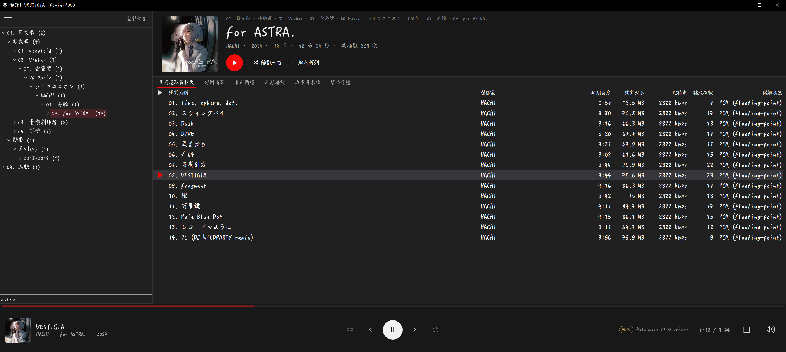

下載：https://github.com/openeric2000/fb2k-nocturne/releases

- 第一次安裝：下載**完整版**。
- 已經裝過 Nocturne：下載**更新版**，做法見[「更新到新版」](#更新到新版)。

建議裝在全新安裝的 foobar2000 上。若裝在已經在用的 foobar2000 上會覆蓋你的介面設定、字型和播放清單，請先備份，詳見[「安裝」](#安裝)。

## 功能

v1.50 新增：展開頁可以切換六種顯示內容（含 VU 表與頻譜）、點封面看曲目資訊卡、資料夾樹可以暫時藏起伴奏版、加入佇列不再重複；提示與滑鼠提示換成統一的外觀。

下面說的「設定頁」是 File → Preferences → Tools → Nocturne，見[「設定頁」](#設定頁)。

### 展開播放頁

點一下播放列就能展開播放頁，看大封面和歌詞，再點一下收回：

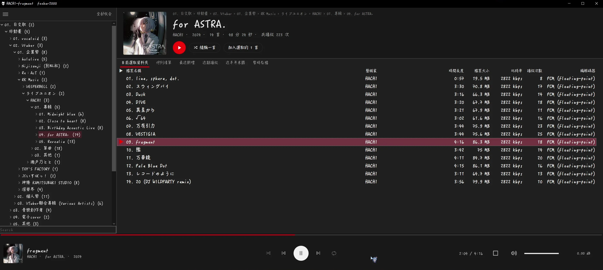

### 展開頁的顯示內容

左上角的按鈕可以切換展開頁要看什麼：純封面、封面＋歌詞、VU 表、頻譜、歌詞＋VU 表、歌詞＋頻譜。左鍵換下一種，右鍵跳出縮圖直接挑；不需要的可以在設定頁「展開頁」分頁取消勾選。VU 表和頻譜上按右鍵可以換樣式。

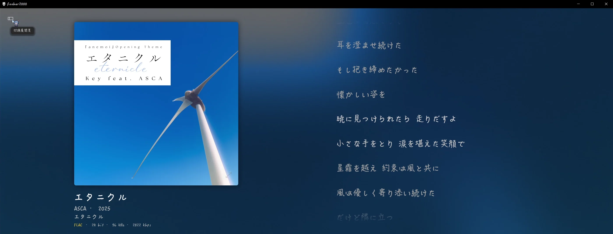

點封面會換成曲目資訊卡（作曲、作詞、編曲、播放次數等），再點一下換回封面；看封面大圖改用封面右下角的小放大鈕。歌詞預設防誤拖：在歌詞上按住左鍵拖曳不會跳時間，滾輪和右鍵照常。

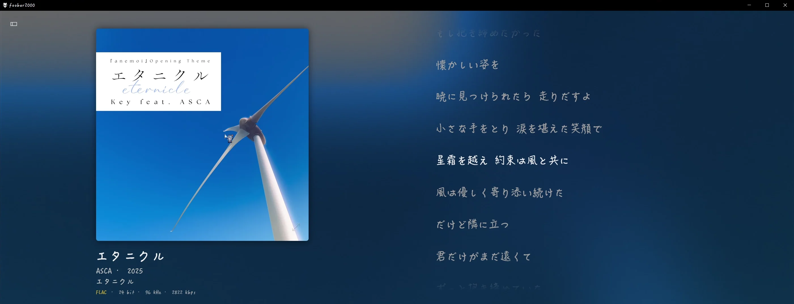

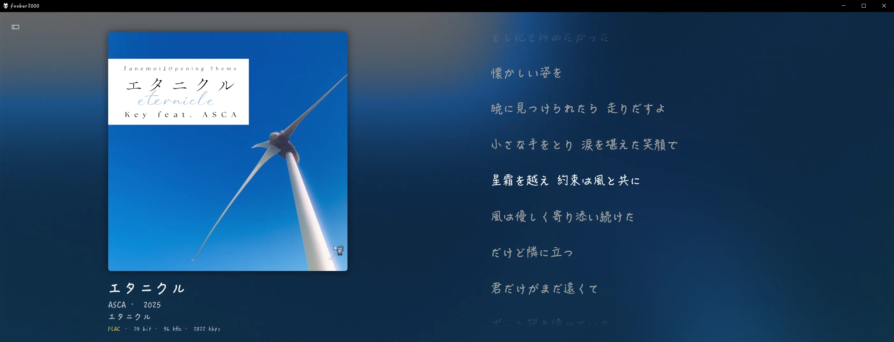

### 封面虛化背景

展開播放頁的背景會換成目前歌曲封面的柔和虛化色彩，每首歌都不一樣。不喜歡的話，可以到設定頁「展開頁」分頁關掉或調整亮度。

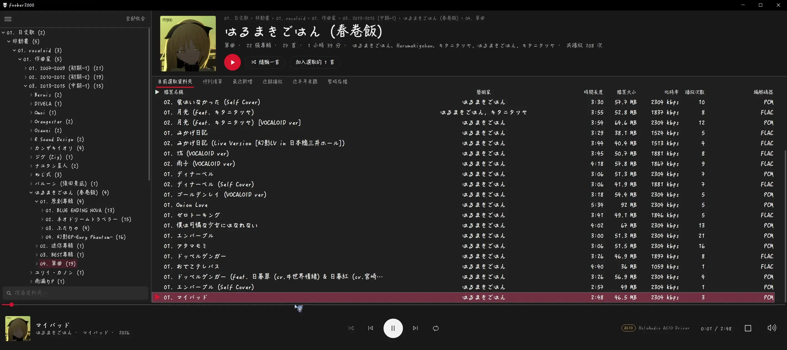

### 輸出裝置

播放列上會顯示現在聲音從哪個裝置出去：左邊是輸出類型（預設、獨占、ASIO、靜音），右邊是裝置名稱。滑鼠移上去看完整名稱和輸出模式，點一下可以直接切換裝置。

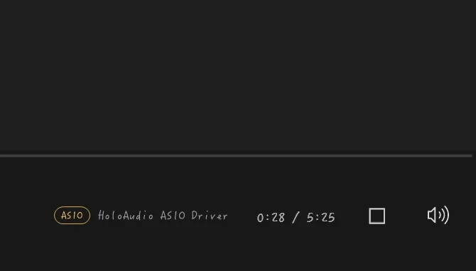

顯示的名稱可以自訂（例如 `Holo Audio=DAC (Holo Audio)`），不想要也能關掉，都在設定頁「播放」分頁。

### 佇列清單

專輯標頭的「加入佇列」按鈕會把整份清單加進播放佇列；先反白幾首，就只加那幾首。切到「佇列清單」分頁可以看佇列內容：反白幾首後按「清除選取的 N 首」只移出那幾首；沒反白時按「清除佇列」，3 秒內再按一次才會清空整份佇列。

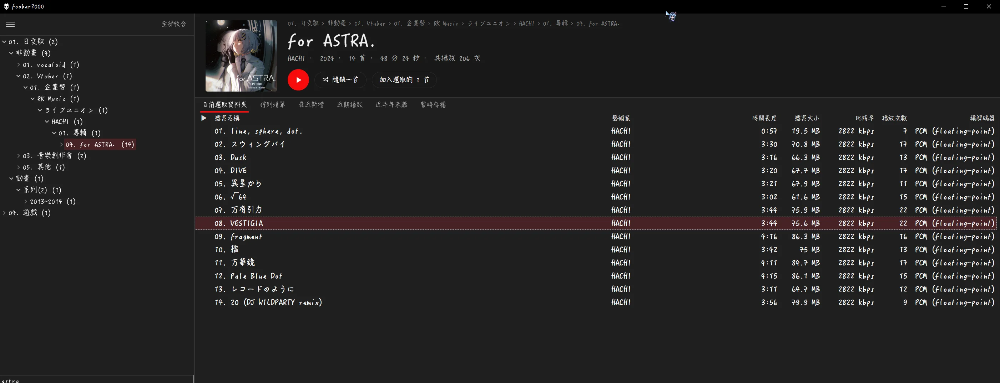

已經在佇列裡的歌不會再加一次（想允許重複，到設定頁「下一首與佇列」分頁勾選）。播放別首歌（雙擊、Enter、右鍵 Play）時預設會保留佇列；想改回 foobar2000 原本的做法（播放別首歌就清掉佇列），到同一個分頁取消勾選。

### 下一首提示

在展開的播放頁，歌曲快結束時，右下角會跳出下一首的封面、曲名、歌手和倒數秒數，倒數到 0 就換歌；滑鼠移到卡片上點一下就立即播放。秒數和位置可以到設定頁「下一首與佇列」分頁調整。

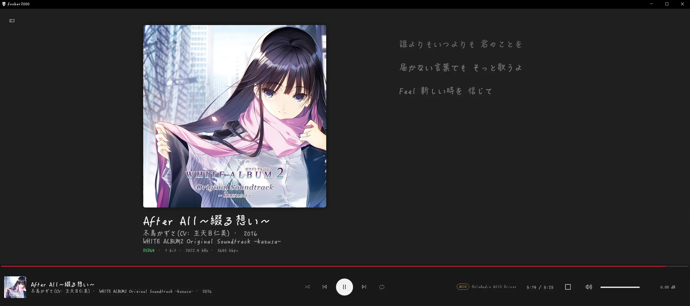

### 設定頁

主題自己的設定在 File → Preferences → Tools → Nocturne，分成播放、下一首與佇列、字型、介面、展開頁、資料夾、關於七個分頁，改了立刻生效。

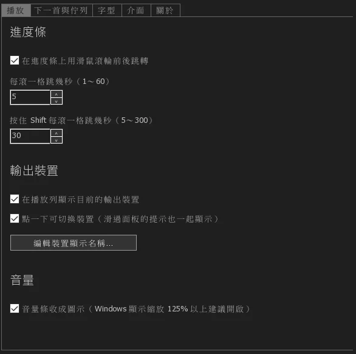

## 需求

- Windows 10 或 11
- foobar2000 2.x **64 位元**（不支援 32 位元）
- 建議裝在 SSD。裝在 HDD 的話，第一次啟動會比較慢。

## 安裝

下面常會提到**設定資料夾**：攜帶版是 `foobar2000.exe` 旁邊的 `profile` 資料夾；安裝版是 `%APPDATA%\foobar2000-v2`（貼到檔案總管的網址列，按 Enter 就會打開）。

先看你是哪一種情況：

| 你的情況 | 怎麼做 |
|----------|--------|
| 全新的 foobar2000（建議） | 照下面[第 1～4 步](#第-1-步先安裝-foobar2000-和三個必要元件一定要先做) |
| 已經在用的 foobar2000，沒裝過 Nocturne | **先備份設定資料夾**，再照[第 1～4 步](#第-1-步先安裝-foobar2000-和三個必要元件一定要先做)。原本的介面設定會被主題取代，詳見[「裝在已經在用的 foobar2000 上」](#裝在已經在用的-foobar2000-上) |
| 已經裝過 Nocturne v1.40，想換同一種語言的新版 | 下載更新版 ZIP，看[「更新到新版」](#更新到新版) |
| 裝的是 v1.30 或更舊的 Nocturne | **先備份設定資料夾**，用完整版整包覆蓋（照[第 2 步](#第-2-步關掉-fb2k把-zip-的內容複製到設定資料夾)）。更新版只適用於從 v1.40 更新 |
| 想把中文版換成英文版（或反過來） | 用完整版整包覆蓋（照[第 2 步](#第-2-步關掉-fb2k把-zip-的內容複製到設定資料夾)）。不能用更新版，否則播放列會變成空白 |

### 第 1 步：先安裝 foobar2000 和三個必要元件（一定要先做）

下面三個元件的作者沒有開放隨包轉發，所以這個主題不附，要請你自己從官方網站下載安裝。

**三個都裝好、重開 fb2k 之後，才能進行[第 2 步](#第-2-步關掉-fb2k把-zip-的內容複製到設定資料夾)。** 少裝任何一個，歌詞、專輯標頭或播放次數會無法顯示。

1. 安裝 foobar2000 2.x 64 位元：https://www.foobar2000.org/download （安裝版或攜帶版都可以）
2. 下載三個元件（都是 `.fb2k-component` 檔）：

   | 元件 | 主題哪裡會用到 | 下載 | 測試過的版本 |
   |------|----------------|------|--------------|
   | ESLyric | 播放列、展開播放頁、歌詞 | https://github.com/ESLyric/release/releases | 1.0.7.0（舊版不行） |
   | WebView2（foo_webview2） | 上方的專輯標頭 | https://www.foobar2000.org/components/view/foo_webview2 | 0.3.28 |
   | Playback Statistics（foo_playcount） | 播放次數欄、「近期播放」「近半年未聽」清單 | https://www.foobar2000.org/components/view/foo_playcount | 3.1.11 |

   **已經裝過 ESLyric 的人也要確認版本**：低於 1.0.7.0 的話，播放列的圖示會變成方框、沒有播放鈕，請照下面第 3 步裝新版。

3. 開 fb2k → File → Preferences → Components → 按「Install...」，選剛下載的 `.fb2k-component`。三個都加進去後按 OK，照提示重開 fb2k。
4. 重開後回到 Preferences → Components，確認清單裡有 ESLyric、WebView2、Playback Statistics 三個。

### 第 2 步：關掉 fb2k，把 ZIP 的內容複製到設定資料夾

（這一步用的是完整版 ZIP。）

1. File → Exit 關掉 fb2k。
2. 打開設定資料夾（位置見上面[「安裝」](#安裝)開頭）。
3. 在檔案總管雙擊打開 ZIP → Ctrl+A 全選 → 複製 → 回到設定資料夾貼上。問到要不要取代檔案時，選「取代目的地中的檔案」。

複製完，設定資料夾裡會直接看到 `user-components-x64`、`configuration`、`eslyric-data`、`webview` 這些資料夾；如果它們跑到多一層的資料夾裡，主題就不會生效。`主題說明` 資料夾裝的是這份說明和授權文件，留著或刪掉都可以。

### 第 3 步：開 fb2k，換成主題介面

1. 打開 fb2k。因為多了一個介面元件，fb2k 會跳出視窗讓你選介面，選 Columns UI。
2. 萬一接著跳出「Quick setup – Columns UI」視窗，**直接按 Cancel**，不要點裡面的版面。點了版面再按 OK，主題的版面就會被換掉。

### 第 4 步：加入音樂資料夾

File → Preferences → Media Library → 按「Add...」加入你的音樂資料夾。左側的資料夾樹會照你的資料夾結構顯示。

### 歌詞：怎麼找、存在哪裡、設定在哪

ESLyric 的設定已經幫你調好（隨主題一起安裝），播放時會自動找歌詞：

1. 先找你電腦裡有的歌詞檔：跟歌曲同一個資料夾，或設定資料夾裡的 `lyrics` 資料夾。
2. 找不到才連線到網易雲音樂、酷狗音樂、QQ 音樂、NetEase English、LRCLIB、MiniLyrics、Musixmatch 搜尋。**這時會把歌名與歌手送到這些服務**；不想連線的做法在下面。

找到的同步歌詞，會自動存在設定資料夾裡的 `lyrics` 資料夾，不用另外設定：

- 攜帶版：`foobar2000\profile\lyrics\`
- 安裝版：`%APPDATA%\foobar2000-v2\lyrics\`

想調整歌詞設定，到 File → Preferences → Tools → ESLyric：

- 不想連線搜尋歌詞：「歌詞選項」取消「曲目開始播放時自動搜尋歌詞」；或到「歌詞來源」取消不要的來源（內建的「本機檔案」只讀你電腦裡的歌詞檔）。
- 想要更多歌詞來源：「歌詞來源」頁右上角的「獲取更多...」。
- 歌詞存檔位置、存檔時機：「儲存設定」。
- 想把歌詞存到別的資料夾：見[「小技巧」](#把歌詞改存到其他資料夾)。

## 裝在已經在用的 foobar2000 上

[第 2 步](#第-2-步關掉-fb2k把-zip-的內容複製到設定資料夾)把 ZIP 複製進去、選「取代檔案」的時候，原本的介面設定會被換成主題的。所以請先備份。

### 先備份

1. File → Exit 關掉 fb2k。
2. 把整個設定資料夾複製一份，放到別的地方。
3. 之後想退回去，關掉 fb2k，把備份複製回設定資料夾，問到要不要取代時選「取代」就好。

### 會被換掉的

- **介面設定**：Columns UI 的版面、播放清單的欄位、顏色、狀態列等，都會換成主題的。如果你原本就在用 Columns UI 並調過版面，調整會不見（原本的官方 Columns UI 會直接被主題附的修改版取代，不會衝突）。
- **字型**：清單、分頁、資料夾樹、播放列、展開頁和專輯標頭的字型，會回到主題預設的微軟正黑體 UI。想用別的字型，見[「字型」](#字型)。
- **Album list 的設定**。
- **ESLyric 的設定**：歌詞來源與順序、搜尋與存檔設定、桌面歌詞等，都會換成主題附的。歌詞存檔位置會變成設定資料夾裡的 `lyrics` 資料夾；你原本存在別處的歌詞檔案不會被刪掉，但 ESLyric 不會再去那裡找或存。想保留自己的 ESLyric 設定：複製 ZIP 內容時，對 `configuration\foo_uie_eslyric.dll.cfg` 這個檔案選「略過」，**而且不要複製** `eslyric-data\scripts` 資料夾（只略過設定檔、卻複製了腳本的話，那 7 個線上來源會以勾選的狀態出現在你的來源清單最後面）。
- **專輯標頭頁面**：如果你自己在設定資料夾的 `webview\default\` 放了頁面，會被主題的取代。
- **播放清單**：主題附的五個預設清單（目前選取資料夾、佇列清單、最近新增、近期播放、近半年未聽）會變回預設內容。你自己建的其他清單，檔案不會被刪掉，但不會再出現在清單分頁上（還原備份就找得回來）。

### 不會受影響的

- foobar2000 本身的設定：輸出裝置、媒體庫資料夾、快捷鍵、DSP 等。
- 媒體庫和播放次數紀錄。
- 已經存好的歌詞檔案（但 ESLyric 的設定會被換掉，見上面）。
- 其他元件的設定。

### 不想動到現在的 foobar2000

另外裝一份攜帶版 foobar2000，在那一份上裝主題試試看，現在用的那份完全不會被碰到。

## 更新到新版

已經裝了 Nocturne **v1.40**，要換**同一種語言**的新版時，下載更新版 ZIP（檔名有 `update`，例如 `fb2k-nocturne-v1.50-update-zh-TW.zip`）。直接解壓縮覆蓋就好：

1. File → Exit 關掉 fb2k。
2. 在檔案總管雙擊打開更新版 ZIP → Ctrl+A → 複製 → 貼到設定資料夾（位置見[「安裝」](#安裝)開頭），問到要不要取代檔案時選「取代目的地中的檔案」。（檔案總管會把資料夾合併，只換同名的檔案，你其他的元件和檔案不會被刪掉。）
3. 重開 fb2k。

會換成新版的：

- 三個元件（Columns UI、Album list、foo_queue_mirror）。
- ESLyric 的版面 `main.xml` 與線上歌詞來源腳本。
- 專輯標頭網頁（`webview`）。
- 沒封面時顯示的唱片圖 `no-cover.png`。

**v1.50 的更新版不會動到你的設定**：Columns UI 設定檔（版面、歌曲清單欄位、字型與配色、設定頁的選項）和 ESLyric 設定檔都不在更新版裡，你在 v1.40 之後自己調的都會留著。播放清單、媒體庫、fb2k 的核心設定、你的歌詞檔案也不會動。

注意：

- 自己改過 `main.xml` 的話，更新後要重新改一次；播放列、展開頁和專輯標頭的字型會回到預設，到設定頁「字型」分頁再選一次就好。
- 裝的是 v1.30 或更舊的版本，不能用這個更新版（少了 v1.40 才有的設定）；請先備份設定資料夾，再用完整版整包覆蓋。
- 想換語言（中文版換英文版，或反過來）不能用更新版，否則播放列會變成空白；要照[「裝在已經在用的 foobar2000 上」](#裝在已經在用的-foobar2000-上)用完整版整包覆蓋，先備份。不確定的話也用這個做法。

## 字型

主題預設用 Windows 內建的**微軟正黑體 UI**，不用另外安裝。微軟正黑體以繁體中文為主，日文歌名裡有些字可能沒有收錄；日文歌多的話，建議換成下面的推薦字型。

### 推薦字型

想要有中日文都較齊全的字型，可以改用下面這幾個免費字型。以約 10 萬個中日文歌名與資料夾名實測，缺字都在 0.2% 以下：

| 字型 | 風格 | 缺字 | 下載 |
|------|------|------|------|
| 霞鶩文楷 TC（LXGW WenKai TC） | 手寫楷體，跟主題風格最搭（推薦） | 0.17% | https://github.com/lxgw/LxgwWenkaiTC/releases |
| 昭源黑體（Chiron Hei HK） | 黑體，乾淨好讀 | 0.06% | https://github.com/chiron-fonts/chiron-hei-hk/releases |
| Chiron GoRound TC | 圓體，比較柔和 | 0.19% | https://github.com/chiron-fonts/chiron-go-round-tc/releases |

下載後對字型檔按右鍵 →「安裝」（或「為所有使用者安裝」），再照下面的方式換掉主題字型。

### 換成自己喜歡的字型

到設定頁「字型」分頁換：

- 最上面一列「全部區塊」一次換掉全部。
- 播放清單、分頁標籤、資料夾樹、其餘介面文字：字型和大小都能換，選了馬上套用。
- 播放列與展開頁、專輯標頭：只能換字型（大小固定），要重開 foobar2000 才生效，換過後分頁底下會出現「立即重開」。

主選單 View → Layout → 主題字型…（左上角 ☰ → View → Layout 也找得到）會直接打開這個分頁。

### 歌詞的字型

歌詞字型不在上面，要在 ESLyric 裡換：

- 歌詞：在歌詞上按右鍵 → Panel Options...（中文介面叫「面板參數選項」）。
- 桌面歌詞（預設沒開）：File → Preferences → Tools → ESLyric → 桌面歌詞 → 顯示設定。

## 小技巧

### 指定快捷鍵，一按就跳到正在播放的那首

給 foobar2000 的「Activate now playing」指定快捷鍵，在很長的清單裡一按就能找到並選取正在播放的那一首。這是 foobar2000 本身的設定，要自己設定一次（下面用 `F4` 當範例）：

1. File → Preferences → Keyboard Shortcuts，按「Add new」。
2. 在下方 Action 區的「Filter list by」輸入 `Activate now playing`，在清單裡點 View → Playlist view → Activate now playing。
3. 在最下方的 Key 欄位裡按下要用的按鍵，按 Apply → OK。

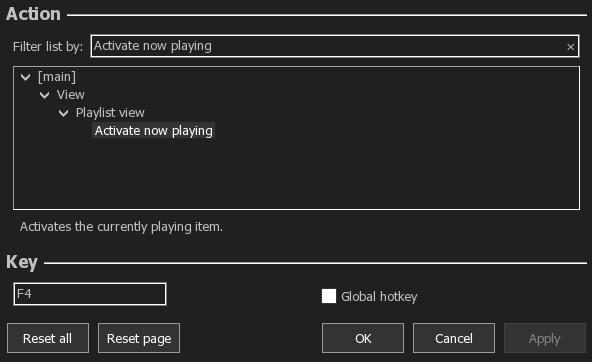

### 把歌詞改存到其他資料夾

想把歌詞集中放在別的位置（例如另一顆硬碟，方便備份），可以用「目錄連接點」讓 `lyrics` 資料夾指向新位置，不用改任何外掛設定。

1. 完全關閉 fb2k。
2. 在想存放歌詞的位置建立好資料夾，例如 `D:\音樂\歌詞`。
3. 把原本 `lyrics` 資料夾裡的檔案搬到新資料夾，再把原本的 `lyrics` 資料夾刪掉或改名（連結的位置不能已經有同名資料夾）。
4. 開啟命令提示字元（cmd），執行（攜帶版把前面的路徑換成 `foobar2000\profile\lyrics` 的完整路徑）：

   `mklink /J "%APPDATA%\foobar2000-v2\lyrics" "D:\音樂\歌詞"`

5. 確認 `lyrics` 變成帶小箭頭的圖示，再開 fb2k 測試。

注意事項：

- 前面的路徑是「連結的位置」，後面是「實際存放的資料夾」，順序不能寫反。
- `/J` 不需要系統管理員權限，但目標只能是本機磁碟（含外接硬碟），不能是網路磁碟機；目標硬碟沒接上時，fb2k 會讀不到、存不了歌詞。
- 要取消時，直接刪除連結資料夾即可，不會影響目標資料夾裡的檔案。

## 注意

- **不要用 fb2k 的元件更新取代 Columns UI。** 這個主題用的是修改版 Columns UI，換成官方版會少掉展開播放頁、底線式分頁等功能。
- **Album list 也一樣（v1.40 起）。** 主題附的是修改版，換成官方版會失去新的搜尋框外觀與「搜尋專輯清單」命令；需要時重新放回 ZIP 裡的檔案。
- 要還原成原本的 fb2k：刪掉整個設定資料夾，重新安裝或解壓官方版。

## 授權

- 主題本身（ESLyric 佈局與設定檔、專輯標頭網頁、設定檔、預設播放清單、說明文件）：MIT License，見 [LICENSE](LICENSE)
- 隨包附上的 ESLyric 歌詞來源腳本，來自 ESLyric 官方腳本庫，作者沒有附授權條款，出處與說明見 [THIRD-PARTY-NOTICES.md](THIRD-PARTY-NOTICES.md)
- 修改版 Columns UI 與其他隨包附上的元件：見 [THIRD-PARTY-NOTICES.md](THIRD-PARTY-NOTICES.md)
